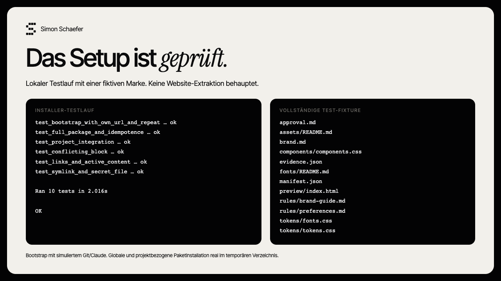

# claude-brand-kit



Ein Claude-Code-Skill, der deine eigene Website als Quelle liest und daraus ein lokales Markenpaket erstellt. Mit Regeln, Charakter, Tokens, Schriften, Logo/Assets und wiederverwendbaren Komponenten. Du prüfst den Entwurf, bevor Claude ihn dauerhaft einbindet und deinen persönlichen Marken-Skill erstellt.

## Start

Voraussetzungen: Claude Code installiert und angemeldet, Git, Python 3.10+. macOS/Linux oder Windows mit WSL. [Einrichtung](SETUP.md).

Ein Befehl im Terminal installiert den Skill, fragt nach deiner Website und startet Claude Code:

```bash
bash <(curl -fsSL https://raw.githubusercontent.com/simon-schaeferai/claude-brand-kit/main/scripts/bootstrap.sh)
```

Der Befehl lädt und führt das öffentliche Bootstrap-Skript aus. Zum vorherigen Prüfen: [bootstrap.sh](scripts/bootstrap.sh). Dein Claude-Abo bzw. deine normale Claude-Abrechnung gilt; es werden keine weiteren Dienste eingerichtet.

Claude untersucht die Website und zeigt einen Markenentwurf mit Quellen und Vorschau. Du gibst das Paket frei und wählst: global für deine Marke oder nur in einem Projekt. Die bestehende Website wird nicht umgebaut.

Später direkt in Claude Code:

```text
/brand-setup https://deine-website.de
```

## Was dauerhaft bleibt

- **`SKILL.md`** steuert Extraktion und Abnahme, ohne Claude Design oder DesignSync.
- **`references/`** definiert Evidenz und vollständiges Markenpaket.
- **`scripts/install.py`** prüft Dateien, Hashes und lokale Verweise. Es installiert das ganze Paket und ergänzt `CLAUDE.md`.

Zusätzlich erhältst du einen eigenen Skill `/<marke>-brand`, ähnlich einem persönlichen Markenhandbuch für Claude. Der Regelblock lädt ihn vor Visual-Arbeit für deine Marke. `brand-setup` bleibt für die Einrichtung zuständig.

Global liegt dein Paket unter `~/.claude/brands/<marke>/`, projektspezifisch unter `.claude/brands/<marke>/`. Bestehende Regeln bleiben erhalten. Identische Wiederholungen ändern nichts; abweichende bestehende Pakete werden nicht überschrieben. Mehrere Marken werden nach Absender gewählt, Konflikte werden zur Klärung vorgelegt.

## Grenzen

Die Website ist Evidenz, keine vollständige Markenstrategie. Abgeleitete Vorschläge und ungeprüfte Werte sind gekennzeichnet. JS, Login und Bot-Schutz können die Extraktion begrenzen. Ohne Browser gibt es keine visuelle Renderprüfung. Schriftdateien werden nur mit belegtem Nutzungsrecht übernommen; sonst bleibt ein dokumentierter Fallback. Keine automatische perfekte Komplettrekonstruktion.

[Prüfumfang und Entwickler-Tests](docs/verification.md) · [Claude-Code-Skills](https://code.claude.com/docs/en/skills) · [CLAUDE.md](https://code.claude.com/docs/en/memory)

## Lizenz

MIT. Extrahierte Markenassets und Fonts behalten ihre eigenen Rechte.
